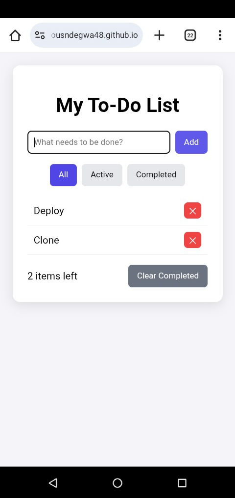

# Week 5: DOM Manipulation - Interactive To-Do List

## Author
- **Name:** Precious Ndegwa
- **GitHub:** [@preciousndegwa48](https://github.com/preciousndegwa48)
- **Date:** November 10, 2026

## Project Description
Interactive To-Do List application built with vanilla JavaScript. The app lets you add, complete, edit, delete, and filter tasks, with todos saved in localStorage so they persist after refresh. The repo also contains the Lessons 9-10 DOM practice page and Daily Challenges Day 1-5.

## Technologies Used
- HTML5
- CSS3
- JavaScript
- DOM API
- localStorage

## Features
- Add tasks with Enter or Add button, empty tasks blocked, input clears after adding
- Click task to toggle completed with strikethrough styling
- Delete button per task
- Filters: All / Active / Completed
- Stats: items left count
- Clear Completed button
- Bonus: Double-click to edit task (Enter to save, Escape to cancel)
- Persistence: todos saved in localStorage
- Practice page: selecting, traversing, modifying, adding/removing elements, events, bubbling/delegation, form validation
- Daily Challenges: Color Changer, Add Paragraph, Remove Images, Copy Content, Dark Mode Toggle

## How to Run
1. Clone this repository
2. Open `index.html` in your browser
   OR
   Open `dom-practice.html` for the practice page and open DevTools Console (F12) to see the logs

## Lessons Learned
- How to select elements with getElementById, querySelector, querySelectorAll, getElementsByClassName, getElementsByTagName
- How to traverse the DOM with parentElement, children, siblings
- Difference between textContent (safe for user input) and innerHTML (can run code)
- How to create, append, insert, clone, and remove elements dynamically
- How to use addEventListener, the event object (target, type, key, clientX/Y), preventDefault
- Event bubbling order (Child -> Parent -> Grandparent) and why event delegation with closest() is better than adding a listener to every item
- Form handling with FormData, real-time validation, and showError/clearError
- How to keep UI and state in sync with render functions

## Challenges Faced
- **Duplicate `const` declarations:** I declared `h1` and `article` twice in `dom.js`, which caused `SyntaxError: Identifier has already been declared` and stopped the whole file. Fixed by declaring once and reusing the variable.
- **New tasks not responding to clicks:** Fixed by using event delegation — one listener on the parent `ul` with `event.target.closest("li")` instead of a listener per item.
- **Edit mode conflicting with toggle:** Fixed by handling double-click separately and using Enter to save / Escape to cancel, with blur to save.

## Screenshots (optional)

## Live Demo (if deployed)
[View Live Demo](https://preciousndegwa48.github.io/iyf-s12-week-05-preciousndegwa48/)

